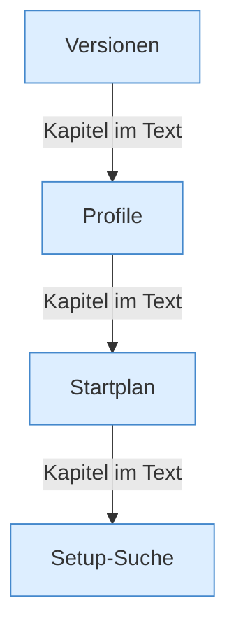

[[00 Start]] › [[Server-Anlage]]

# Server-Anlage



```knoten
Versionen
  Welche [[Glossar#Version|Versionen]] es gibt und welche das [[Glossar#Plugin|Plugin]] als stabil nimmt.
Profile
  Die Beschreibung eines Servers: Name, [[Glossar#Version|Version]], Ordner, Speicher.
Startplan
  Was zum Starten gebraucht wird: Eigenschaften, ein geprüfter Ordner, die Argumente, die [[Glossar#Programmdatei|Programmdatei]].
Setup-Suche
  Sucht auf der Festplatte nach einer schon vorhandenen Anlage und kann sie wieder benutzbar machen.
```

> [!knoten] Was die Blöcke tun
> - **Versionen**: Welche [[Glossar#Version|Versionen]] es gibt und welche das [[Glossar#Plugin|Plugin]] als stabil nimmt.
> - **Profile**: Die Beschreibung eines Servers: Name, [[Glossar#Version|Version]], Ordner, Speicher.
> - **Startplan**: Was zum Starten gebraucht wird: Eigenschaften, ein geprüfter Ordner, die Argumente, die [[Glossar#Programmdatei|Programmdatei]].
> - **Setup-Suche**: Sucht auf der Festplatte nach einer schon vorhandenen Anlage und kann sie wieder benutzbar machen.

- Alles vor dem ersten Start: [[Glossar#Version|Version]], die Beschreibung des Servers und der [[Glossar#Startplan|Startplan]]. Die [[Glossar#Einstellungsdatei|Einstellungsdatei]] kann mehrere Server nennen, benutzt wird der erste.
