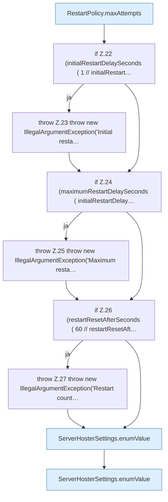

[[00 Start]] › [[Plugin-Kern]] › [[Konfiguration]] › [[ServerHosterSettings]] › [[ServerHosterSettings.ServerHosterSettings]] › [[ServerHosterSettings.ServerHosterSettings.Teil1]]

# ServerHosterSettings.ServerHosterSettings.Teil1



```knoten
RestartPolicy.maxAttempts
  Dieser Teil macht hier einen einzelnen Schritt. Eine Ebene tiefer steht er genauer. Begrenzt nach oben `maxAttempts`.
if Z.22 (initialRestartDelaySeconds ( 1 // initialRestart…
  Zeile 22: prüft `(initialRestartDelaySeconds ( 1 // initialRestart…`.
throw Z.23 throw new IllegalArgumentException('Initial resta…
  Zeile 23: Abbruch `throw new IllegalArgumentException('Initial resta…`.
if Z.24 (maximumRestartDelaySeconds ( initialRestartDelay…
  Zeile 24: prüft `(maximumRestartDelaySeconds ( initialRestartDelay…`.
throw Z.25 throw new IllegalArgumentException('Maximum resta…
  Zeile 25: Abbruch `throw new IllegalArgumentException('Maximum resta…`.
if Z.26 (restartResetAfterSeconds ( 60 // restartResetAft…
  Zeile 26: prüft `(restartResetAfterSeconds ( 60 // restartResetAft…`.
throw Z.27 throw new IllegalArgumentException('Restart count…
  Zeile 27: Abbruch `throw new IllegalArgumentException('Restart count…`.
ServerHosterSettings.enumValue
  Dieser Teil kümmert sich um den Wert. `enumValue` in `ServerHosterSettings.java`.
```

> [!knoten]- Was die Blöcke tun
> - **RestartPolicy.maxAttempts**: Dieser Teil macht hier einen einzelnen Schritt. Eine Ebene tiefer steht er genauer. Begrenzt nach oben `maxAttempts`.
> - **if Z.22 (initialRestartDelaySeconds ( 1 // initialRestart…**: Zeile 22: prüft `(initialRestartDelaySeconds ( 1 // initialRestart…`.
> - **throw Z.23 throw new IllegalArgumentException('Initial resta…**: Zeile 23: Abbruch `throw new IllegalArgumentException('Initial resta…`.
> - **if Z.24 (maximumRestartDelaySeconds ( initialRestartDelay…**: Zeile 24: prüft `(maximumRestartDelaySeconds ( initialRestartDelay…`.
> - **throw Z.25 throw new IllegalArgumentException('Maximum resta…**: Zeile 25: Abbruch `throw new IllegalArgumentException('Maximum resta…`.
> - **if Z.26 (restartResetAfterSeconds ( 60 // restartResetAft…**: Zeile 26: prüft `(restartResetAfterSeconds ( 60 // restartResetAft…`.
> - **throw Z.27 throw new IllegalArgumentException('Restart count…**: Zeile 27: Abbruch `throw new IllegalArgumentException('Restart count…`.
> - **ServerHosterSettings.enumValue**: Dieser Teil kümmert sich um den Wert. `enumValue` in `ServerHosterSettings.java`.

- Ein weiterer Abschnitt derselben Übersicht.
- Fortsetzung von `ServerHosterSettings.ServerHosterSettings`.
