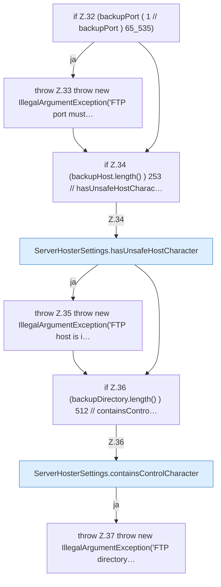

[[00 Start]] › [[Plugin-Kern]] › [[Konfiguration]] › [[ServerHosterSettings]] › [[ServerHosterSettings.ServerHosterSettings]] › [[ServerHosterSettings.ServerHosterSettings.Teil2]]

# ServerHosterSettings.ServerHosterSettings.Teil2



```knoten
if Z.32 (backupPort ( 1 // backupPort ) 65_535)
  Zeile 32: prüft `(backupPort ( 1 // backupPort ) 65_535)`.
throw Z.33 throw new IllegalArgumentException('FTP port must…
  Zeile 33: Abbruch `throw new IllegalArgumentException('FTP port must…`.
if Z.34 (backupHost.length() ) 253 // hasUnsafeHostCharac…
  Zeile 34: prüft `(backupHost.length() ) 253 // hasUnsafeHostCharac…`.
ServerHosterSettings.hasUnsafeHostCharacter
  Dieser Teil prüft den [[Glossar#Host|Host]]. Prüft `hasUnsafeHostCharacter`.
throw Z.35 throw new IllegalArgumentException('FTP host is i…
  Zeile 35: Abbruch `throw new IllegalArgumentException('FTP host is i…`.
if Z.36 (backupDirectory.length() ) 512 // containsContro…
  Zeile 36: prüft `(backupDirectory.length() ) 512 // containsContro…`.
ServerHosterSettings.containsControlCharacter
  Dieser Teil macht hier einen einzelnen Schritt. Eine Ebene tiefer steht er genauer. Prüft, ob enthalten `containsControlCharacter`.
throw Z.37 throw new IllegalArgumentException('FTP directory…
  Zeile 37: Abbruch `throw new IllegalArgumentException('FTP directory…`.
```

> [!knoten]- Was die Blöcke tun
> - **if Z.32 (backupPort ( 1 // backupPort ) 65_535)**: Zeile 32: prüft `(backupPort ( 1 // backupPort ) 65_535)`.
> - **throw Z.33 throw new IllegalArgumentException('FTP port must…**: Zeile 33: Abbruch `throw new IllegalArgumentException('FTP port must…`.
> - **if Z.34 (backupHost.length() ) 253 // hasUnsafeHostCharac…**: Zeile 34: prüft `(backupHost.length() ) 253 // hasUnsafeHostCharac…`.
> - **ServerHosterSettings.hasUnsafeHostCharacter**: Dieser Teil prüft den [[Glossar#Host|Host]]. Prüft `hasUnsafeHostCharacter`.
> - **throw Z.35 throw new IllegalArgumentException('FTP host is i…**: Zeile 35: Abbruch `throw new IllegalArgumentException('FTP host is i…`.
> - **if Z.36 (backupDirectory.length() ) 512 // containsContro…**: Zeile 36: prüft `(backupDirectory.length() ) 512 // containsContro…`.
> - **ServerHosterSettings.containsControlCharacter**: Dieser Teil macht hier einen einzelnen Schritt. Eine Ebene tiefer steht er genauer. Prüft, ob enthalten `containsControlCharacter`.
> - **throw Z.37 throw new IllegalArgumentException('FTP directory…**: Zeile 37: Abbruch `throw new IllegalArgumentException('FTP directory…`.

- Ein weiterer Abschnitt derselben Übersicht.
- Fortsetzung von `ServerHosterSettings.ServerHosterSettings`.
