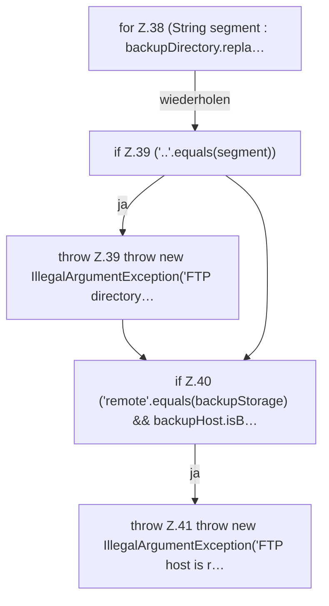

[[00 Start]] › [[Plugin-Kern]] › [[Konfiguration]] › [[ServerHosterSettings]] › [[ServerHosterSettings.ServerHosterSettings]] › [[ServerHosterSettings.ServerHosterSettings.Teil3]]

# ServerHosterSettings.ServerHosterSettings.Teil3

- Fortsetzung von `ServerHosterSettings.ServerHosterSettings`, Quellreihenfolge.
