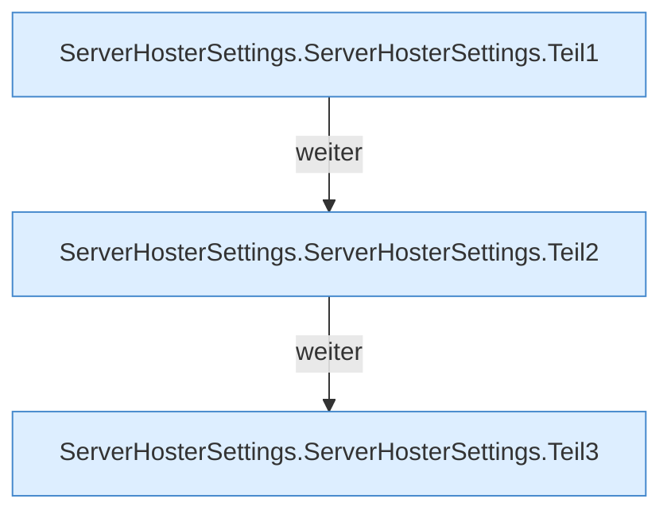

[[00 Start]] › [[Plugin-Kern]] › [[Konfiguration]] › [[ServerHosterSettings]] › [[ServerHosterSettings.ServerHosterSettings]]

# ServerHosterSettings.ServerHosterSettings

`ServerHosterSettings.ServerHosterSettings()` [src/main/java/de/aichele/childlauncher/ServerHosterSettings.java:20–42](https://github.com/Sciddie/minecraft-serverhoster-plugin/blob/95b02b953b0b4c23673e900e021a7c3c844aa37d/src/main/java/de/aichele/childlauncher/ServerHosterSettings.java#L20-L42)

- `ServerHosterSettings` in `src/main/java/de/aichele/childlauncher/ServerHosterSettings.java`
