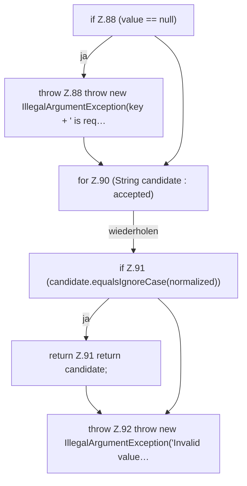

[[00 Start]] › [[Plugin-Kern]] › [[Konfiguration]] › [[ServerHosterSettings]] › [[ServerHosterSettings.enumValue]]

# ServerHosterSettings.enumValue

`ServerHosterSettings.enumValue(String value, String key, String... accepted)` [src/main/java/de/aichele/childlauncher/ServerHosterSettings.java:87–93](https://github.com/Sciddie/minecraft-serverhoster-plugin/blob/95b02b953b0b4c23673e900e021a7c3c844aa37d/src/main/java/de/aichele/childlauncher/ServerHosterSettings.java#L87-L93)



```knoten
if Z.88 (value == null)
  Zeile 88: prüft `(value == null)`.
throw Z.88 throw new IllegalArgumentException(key + ' is req…
  Zeile 88: Abbruch `throw new IllegalArgumentException(key + ' is req…`.
for Z.90 (String candidate : accepted)
  Zeile 90: Schleife `(String candidate : accepted)`.
if Z.91 (candidate.equalsIgnoreCase(normalized))
  Zeile 91: prüft `(candidate.equalsIgnoreCase(normalized))`.
return Z.91 return candidate;
  Zeile 91: Rückgabe `return candidate;`.
throw Z.92 throw new IllegalArgumentException('Invalid value…
  Zeile 92: Abbruch `throw new IllegalArgumentException('Invalid value…`.
```

> [!knoten]- Was die Blöcke tun
> - **if Z.88 (value == null)**: Zeile 88: prüft `(value == null)`.
> - **throw Z.88 throw new IllegalArgumentException(key + ' is req…**: Zeile 88: Abbruch `throw new IllegalArgumentException(key + ' is req…`.
> - **for Z.90 (String candidate : accepted)**: Zeile 90: Schleife `(String candidate : accepted)`.
> - **if Z.91 (candidate.equalsIgnoreCase(normalized))**: Zeile 91: prüft `(candidate.equalsIgnoreCase(normalized))`.
> - **return Z.91 return candidate;**: Zeile 91: Rückgabe `return candidate;`.
> - **throw Z.92 throw new IllegalArgumentException('Invalid value…**: Zeile 92: Abbruch `throw new IllegalArgumentException('Invalid value…`.

- Dieser Teil kümmert sich um den Wert.
- `enumValue` in `src/main/java/de/aichele/childlauncher/ServerHosterSettings.java`
