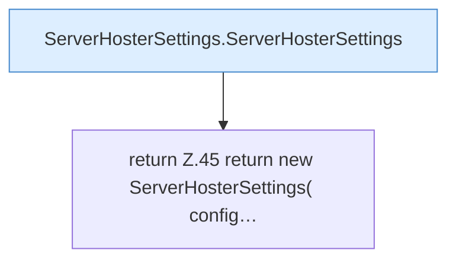

[[00 Start]] › [[Plugin-Kern]] › [[Konfiguration]] › [[ServerHosterSettings]] › [[ServerHosterSettings.from]]

# ServerHosterSettings.from

`ServerHosterSettings.from(FileConfiguration config)` [src/main/java/de/aichele/childlauncher/ServerHosterSettings.java:44–57](https://github.com/Sciddie/minecraft-serverhoster-plugin/blob/95b02b953b0b4c23673e900e021a7c3c844aa37d/src/main/java/de/aichele/childlauncher/ServerHosterSettings.java#L44-L57)



```knoten
ServerHosterSettings.ServerHosterSettings
  Dieser Teil kümmert sich um das [[Glossar#Plugin|Plugin]] die [[Glossar#Einstellungen|Einstellungen]]. `ServerHosterSettings` in `ServerHosterSettings.java`. Ruft `maxAttempts`, `enumValue`, `hasUnsafeHostCharacter`.
return Z.45 return new ServerHosterSettings( config…
  Zeile 45: Rückgabe `return new ServerHosterSettings( config…`.
```

> [!knoten]- Was die Blöcke tun
> - **ServerHosterSettings.ServerHosterSettings**: Dieser Teil kümmert sich um das [[Glossar#Plugin|Plugin]] die [[Glossar#Einstellungen|Einstellungen]]. `ServerHosterSettings` in `ServerHosterSettings.java`. Ruft `maxAttempts`, `enumValue`, `hasUnsafeHostCharacter`.
> - **return Z.45 return new ServerHosterSettings( config…**: Zeile 45: Rückgabe `return new ServerHosterSettings( config…`.

- Dieser Teil macht hier einen einzelnen Schritt. Eine Ebene tiefer steht er genauer.
- `from` in `src/main/java/de/aichele/childlauncher/ServerHosterSettings.java`
