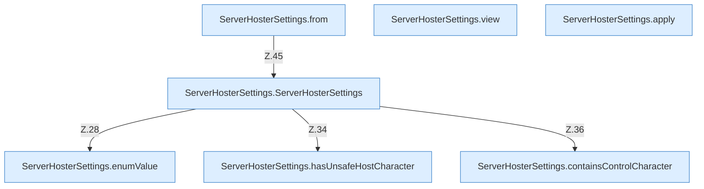

[[00 Start]] › [[Plugin-Kern]] › [[Konfiguration]] › [[ServerHosterSettings]]

# ServerHosterSettings



```knoten
ServerHosterSettings.from
  `from` in `ServerHosterSettings.java`. Ruft `ServerHosterSettings`.
ServerHosterSettings.view
  Liefert die Sicht `view`.
ServerHosterSettings.apply
  Wendet an `apply`.
ServerHosterSettings.enumValue
  `enumValue` in `ServerHosterSettings.java`.
ServerHosterSettings.hasUnsafeHostCharacter
  Prüft `hasUnsafeHostCharacter`.
ServerHosterSettings.containsControlCharacter
  Prüft, ob enthalten `containsControlCharacter`.
ServerHosterSettings.ServerHosterSettings
  `ServerHosterSettings` in `ServerHosterSettings.java`. Ruft `maxAttempts`, `enumValue`, `hasUnsafeHostCharacter`.
```


