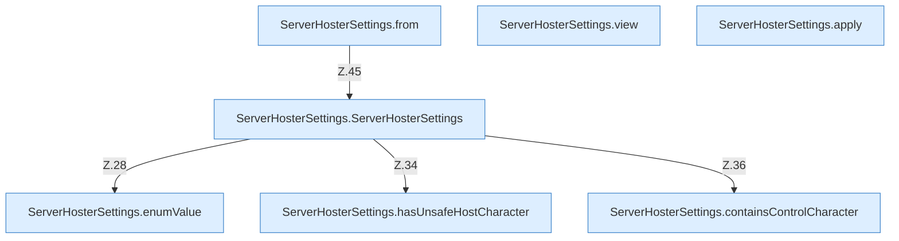

[[00 Start]] › [[Plugin-Kern]] › [[Konfiguration]] › [[ServerHosterSettings]]

# ServerHosterSettings



```knoten
ServerHosterSettings.from
  Dieser Teil macht hier einen einzelnen Schritt. Eine Ebene tiefer steht er genauer. Im [[Glossar#Quelltext|Quelltext]] heißt das `from`.
ServerHosterSettings.view
  Dieser Teil macht hier einen einzelnen Schritt. Eine Ebene tiefer steht er genauer. Im [[Glossar#Quelltext|Quelltext]] heißt das `view`.
ServerHosterSettings.apply
  Dieser Teil wendet an das. Im [[Glossar#Quelltext|Quelltext]] heißt das `apply`.
ServerHosterSettings.enumValue
  Dieser Teil kümmert sich um den Wert. Im [[Glossar#Quelltext|Quelltext]] heißt das `enumValue`.
ServerHosterSettings.hasUnsafeHostCharacter
  Dieser Teil prüft den [[Glossar#Host|Host]]. Im [[Glossar#Quelltext|Quelltext]] heißt das `hasUnsafeHostCharacter`.
ServerHosterSettings.containsControlCharacter
  Dieser Teil macht hier einen einzelnen Schritt. Eine Ebene tiefer steht er genauer. Im [[Glossar#Quelltext|Quelltext]] heißt das `containsControlCharacter`.
ServerHosterSettings.ServerHosterSettings
  Dieser Teil kümmert sich um das [[Glossar#Plugin|Plugin]] die [[Glossar#Einstellungen|Einstellungen]]. Im [[Glossar#Quelltext|Quelltext]] heißt das `ServerHosterSettings`.
```

> [!knoten]- Was die Blöcke tun
> - **ServerHosterSettings.from**: Dieser Teil macht hier einen einzelnen Schritt. Eine Ebene tiefer steht er genauer. Im [[Glossar#Quelltext|Quelltext]] heißt das `from`.
> - **ServerHosterSettings.view**: Dieser Teil macht hier einen einzelnen Schritt. Eine Ebene tiefer steht er genauer. Im [[Glossar#Quelltext|Quelltext]] heißt das `view`.
> - **ServerHosterSettings.apply**: Dieser Teil wendet an das. Im [[Glossar#Quelltext|Quelltext]] heißt das `apply`.
> - **ServerHosterSettings.enumValue**: Dieser Teil kümmert sich um den Wert. Im [[Glossar#Quelltext|Quelltext]] heißt das `enumValue`.
> - **ServerHosterSettings.hasUnsafeHostCharacter**: Dieser Teil prüft den [[Glossar#Host|Host]]. Im [[Glossar#Quelltext|Quelltext]] heißt das `hasUnsafeHostCharacter`.
> - **ServerHosterSettings.containsControlCharacter**: Dieser Teil macht hier einen einzelnen Schritt. Eine Ebene tiefer steht er genauer. Im [[Glossar#Quelltext|Quelltext]] heißt das `containsControlCharacter`.
> - **ServerHosterSettings.ServerHosterSettings**: Dieser Teil kümmert sich um das [[Glossar#Plugin|Plugin]] die [[Glossar#Einstellungen|Einstellungen]]. Im [[Glossar#Quelltext|Quelltext]] heißt das `ServerHosterSettings`.

- Prüft die [[Glossar#Einstellungen|Einstellungen]], bevor sie benutzt werden, zum Beispiel [[Glossar#Pause|Pausen]] und die Angaben für eine Sicherung über das Netz.
