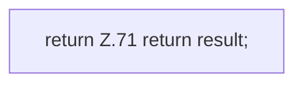

[[00 Start]] › [[Plugin-Kern]] › [[Konfiguration]] › [[ServerHosterSettings]] › [[ServerHosterSettings.view]]

# ServerHosterSettings.view

`ServerHosterSettings.view()` [src/main/java/de/aichele/childlauncher/ServerHosterSettings.java:59–72](https://github.com/Sciddie/minecraft-serverhoster-plugin/blob/95b02b953b0b4c23673e900e021a7c3c844aa37d/src/main/java/de/aichele/childlauncher/ServerHosterSettings.java#L59-L72)

- `view` in `src/main/java/de/aichele/childlauncher/ServerHosterSettings.java`
