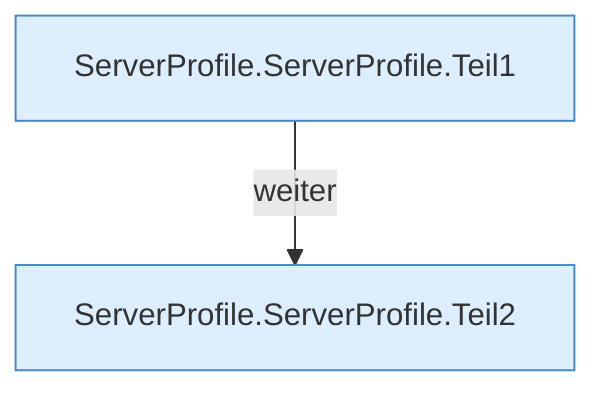

[[00 Start]] › [[Server-Anlage]] › [[Profile]] › [[ServerProfile]] › [[ServerProfile.ServerProfile]]

# ServerProfile.ServerProfile

`ServerProfile.ServerProfile(String id, String type, String mcVersion, int port, String serverIp, String customJar, String fabricLoaderVersion, String fabricInstallerVersion, String workingDir, String xms, String xmx, List<String> jvmFlags, List<String> serverArgs, boolean autoStart, Map<String, String> serverProperties)` [src/main/java/de/aichele/childlauncher/ServerProfile.java:31–50](https://github.com/Sciddie/minecraft-serverhoster-plugin/blob/95b02b953b0b4c23673e900e021a7c3c844aa37d/src/main/java/de/aichele/childlauncher/ServerProfile.java#L31-L50)

- `ServerProfile` in `src/main/java/de/aichele/childlauncher/ServerProfile.java`
