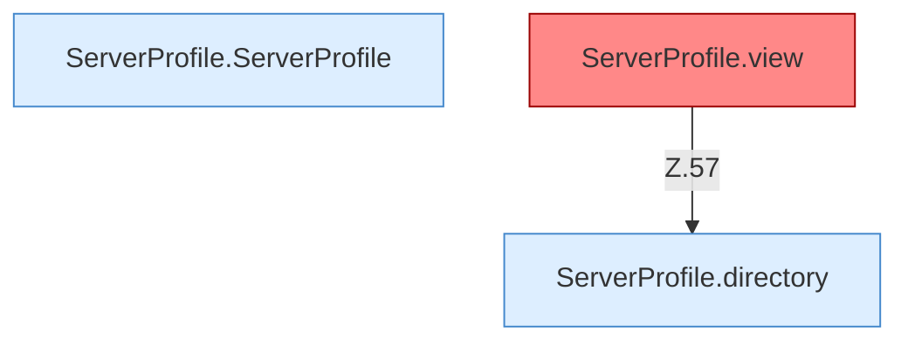

[[00 Start]] › [[Server-Anlage]] › [[Profile]] › [[ServerProfile]]

# ServerProfile



```knoten
ServerProfile.ServerProfile
  `ServerProfile` in `ServerProfile.java`.
ServerProfile.directory
  `directory` in `ServerProfile.java`.
ServerProfile.view
  Liefert die Sicht `view`. Ruft `directory`. Befund: toter Code (wahrscheinlich).
```


