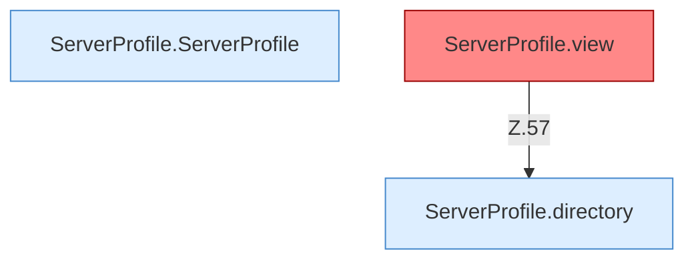

[[00 Start]] › [[Server-Anlage]] › [[Profile]] › [[ServerProfile]]

# ServerProfile



```knoten
ServerProfile.ServerProfile
  Die Serverbeschreibung kümmert sich um die Beschreibung. Im [[Glossar#Quelltext|Quelltext]] heißt das `ServerProfile`.
ServerProfile.directory
  Die Serverbeschreibung macht hier einen einzelnen Schritt. Eine Ebene tiefer steht er genauer. Im [[Glossar#Quelltext|Quelltext]] heißt das `directory`.
ServerProfile.view
  Die Serverbeschreibung macht hier einen einzelnen Schritt. Eine Ebene tiefer steht er genauer. Im [[Glossar#Quelltext|Quelltext]] heißt das `view`. Auffällig: im normalen Betrieb ruft das niemand auf. Das nennt man [[Glossar#Ungenutzt|Ungenutzt]].
```

> [!knoten]- Was die Blöcke tun
> - **ServerProfile.ServerProfile**: Die Serverbeschreibung kümmert sich um die Beschreibung. Im [[Glossar#Quelltext|Quelltext]] heißt das `ServerProfile`.
> - **ServerProfile.directory**: Die Serverbeschreibung macht hier einen einzelnen Schritt. Eine Ebene tiefer steht er genauer. Im [[Glossar#Quelltext|Quelltext]] heißt das `directory`.
> - **ServerProfile.view**: Die Serverbeschreibung macht hier einen einzelnen Schritt. Eine Ebene tiefer steht er genauer. Im [[Glossar#Quelltext|Quelltext]] heißt das `view`. Auffällig: im normalen Betrieb ruft das niemand auf. Das nennt man [[Glossar#Ungenutzt|Ungenutzt]].

- Baut diese Beschreibung aus den [[Glossar#Einstellungen|Einstellungen]]. Fehlt die Art des Servers, nimmt der [[Glossar#Quelltext|Quelltext]] fabric an, die ausgelieferte Datei sagt vanilla.
