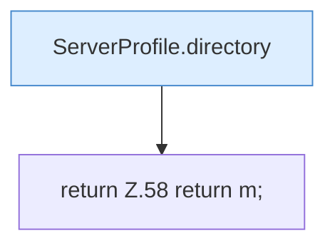

[[00 Start]] › [[Server-Anlage]] › [[Profile]] › [[ServerProfile]] › [[ServerProfile.view]]

# ServerProfile.view

`ServerProfile.view()` [src/main/java/de/aichele/childlauncher/ServerProfile.java:54–59](https://github.com/Sciddie/minecraft-serverhoster-plugin/blob/95b02b953b0b4c23673e900e021a7c3c844aa37d/src/main/java/de/aichele/childlauncher/ServerProfile.java#L54-L59)



```knoten
ServerProfile.directory
  `directory` in `ServerProfile.java`.
return Z.58 return m;
  Zeile 58: Rückgabe `return m;`.
```

- `view` in `src/main/java/de/aichele/childlauncher/ServerProfile.java`
- Befund: toter Code, wahrscheinlich. src/main/java/de/aichele/childlauncher/ServerProfile.java:54–59 kein Produktionsaufruf im Aufrufgraph
