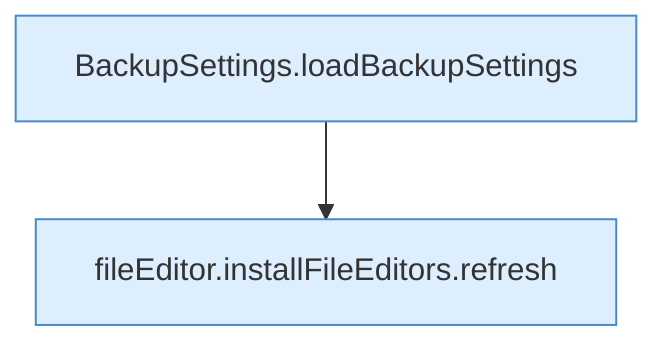

[[00 Start]] › [[Dashboard-UI]] › [[UI-Workflows]] › [[SettingsWorkflow]] › [[SettingsWorkflow.SettingsWorkflow]] › [[SettingsWorkflow.SettingsWorkflow.Teil1]]

# SettingsWorkflow.SettingsWorkflow.Teil1



```knoten
BackupSettings.loadBackupSettings
  Lädt `loadBackupSettings`. Ruft `dashboardRequest`.
fileEditor.installFileEditors.refresh
  Lädt neu `refresh`. Ruft `editorFor`.
```

- Fortsetzung von `SettingsWorkflow.SettingsWorkflow`, Quellreihenfolge.
