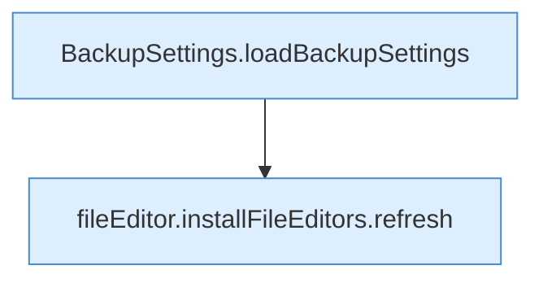

[[00 Start]] › [[Dashboard-UI]] › [[UI-Workflows]] › [[SettingsWorkflow]] › [[SettingsWorkflow.SettingsWorkflow]] › [[SettingsWorkflow.SettingsWorkflow.Teil1]]

# SettingsWorkflow.SettingsWorkflow.Teil1



```knoten
BackupSettings.loadBackupSettings
  Dieser Teil lädt die [[Glossar#Sicherungskopie|Sicherungskopie]] die [[Glossar#Einstellungen|Einstellungen]]. Lädt `loadBackupSettings`. Ruft `dashboardRequest`.
fileEditor.installFileEditors.refresh
  Die [[Glossar#Bedienseite|Bedienseite]] lädt neu das. Lädt neu `refresh`. Ruft `editorFor`.
```

> [!knoten]- Was die Blöcke tun
> - **BackupSettings.loadBackupSettings**: Dieser Teil lädt die [[Glossar#Sicherungskopie|Sicherungskopie]] die [[Glossar#Einstellungen|Einstellungen]]. Lädt `loadBackupSettings`. Ruft `dashboardRequest`.
> - **fileEditor.installFileEditors.refresh**: Die [[Glossar#Bedienseite|Bedienseite]] lädt neu das. Lädt neu `refresh`. Ruft `editorFor`.

- Ein weiterer Abschnitt derselben Übersicht.
- Fortsetzung von `SettingsWorkflow.SettingsWorkflow`.
