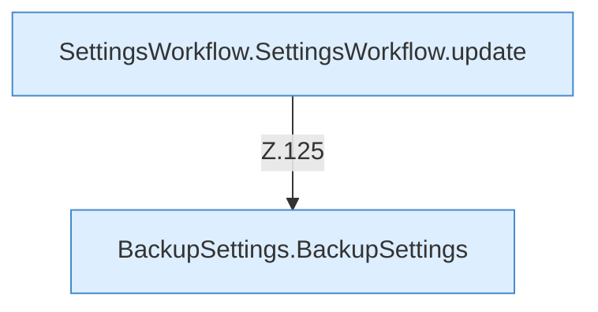

[[00 Start]] › [[Dashboard-UI]] › [[UI-Workflows]] › [[SettingsWorkflow]] › [[SettingsWorkflow.SettingsWorkflow]] › [[SettingsWorkflow.SettingsWorkflow.Teil2.Calls118]]

# SettingsWorkflow.SettingsWorkflow.Teil2.Calls118



```knoten
SettingsWorkflow.SettingsWorkflow.update
  Die [[Glossar#Bedienseite|Bedienseite]] ändert das. Aktualisiert `update`.
BackupSettings.BackupSettings
  Dieser Teil sichert die [[Glossar#Einstellungen|Einstellungen]]. Sichert `BackupSettings`.
```

> [!knoten]- Was die Blöcke tun
> - **SettingsWorkflow.SettingsWorkflow.update**: Die [[Glossar#Bedienseite|Bedienseite]] ändert das. Aktualisiert `update`.
> - **BackupSettings.BackupSettings**: Dieser Teil sichert die [[Glossar#Einstellungen|Einstellungen]]. Sichert `BackupSettings`.

- Weitere [[Glossar#Funktion|Funktionen]], die ab [[Glossar#Zeile|Zeile]] 118 aufgerufen werden.
- Fortsetzung von `SettingsWorkflow.SettingsWorkflow.Teil2`.
