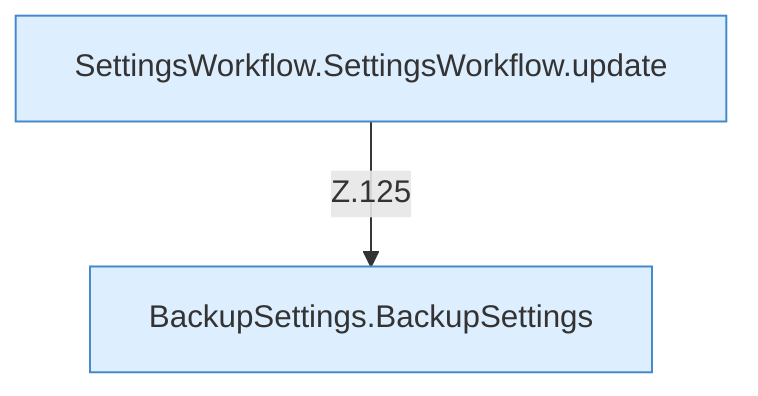

[[00 Start]] › [[Dashboard-UI]] › [[UI-Workflows]] › [[SettingsWorkflow]] › [[SettingsWorkflow.SettingsWorkflow]] › [[SettingsWorkflow.SettingsWorkflow.Teil2.Calls118]]

# SettingsWorkflow.SettingsWorkflow.Teil2.Calls118



```knoten
SettingsWorkflow.SettingsWorkflow.update
  Aktualisiert `update`.
BackupSettings.BackupSettings
  Sichert `BackupSettings`.
```

- Fortsetzung von `SettingsWorkflow.SettingsWorkflow.Teil2`, Quellreihenfolge.
