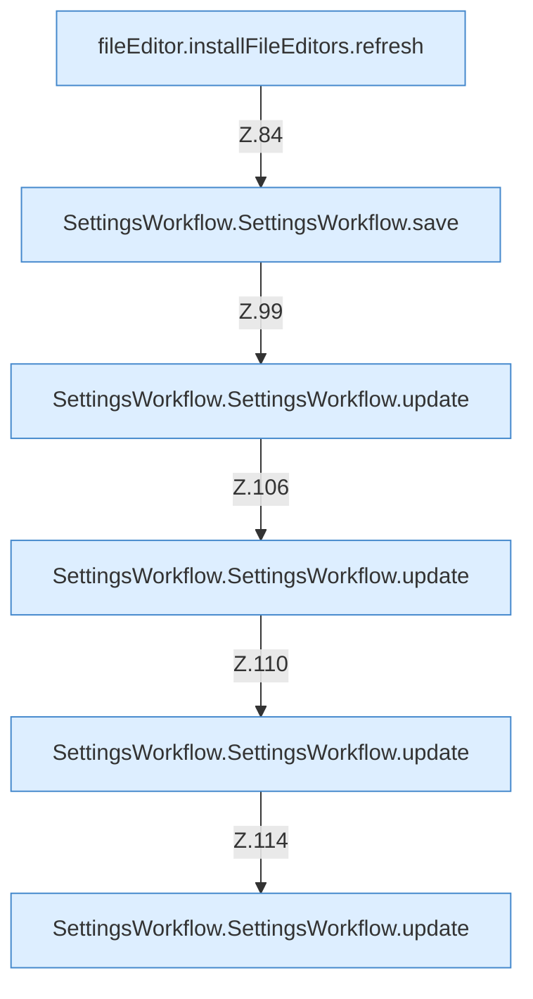

[[00 Start]] › [[Dashboard-UI]] › [[UI-Workflows]] › [[SettingsWorkflow]] › [[SettingsWorkflow.SettingsWorkflow]] › [[SettingsWorkflow.SettingsWorkflow.Teil2.Calls81]]

# SettingsWorkflow.SettingsWorkflow.Teil2.Calls81



```knoten
fileEditor.installFileEditors.refresh
  Lädt neu `refresh`. Ruft `editorFor`.
SettingsWorkflow.SettingsWorkflow.save
  Speichert `save`. Ruft `saveBackupSettings`, `loadBackupSettings`.
SettingsWorkflow.SettingsWorkflow.update
  Aktualisiert `update`.
```

- Fortsetzung von `SettingsWorkflow.SettingsWorkflow.Teil2`, Quellreihenfolge.
