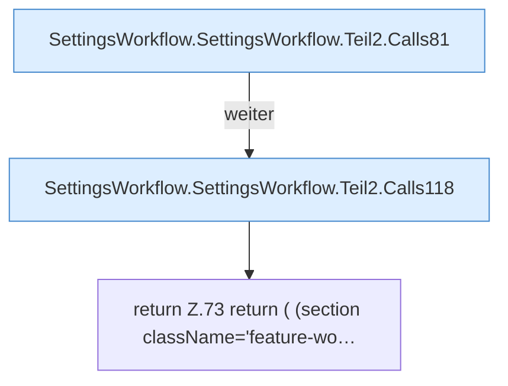

[[00 Start]] › [[Dashboard-UI]] › [[UI-Workflows]] › [[SettingsWorkflow]] › [[SettingsWorkflow.SettingsWorkflow]] › [[SettingsWorkflow.SettingsWorkflow.Teil2]]

# SettingsWorkflow.SettingsWorkflow.Teil2

- Fortsetzung von `SettingsWorkflow.SettingsWorkflow`, Quellreihenfolge.
