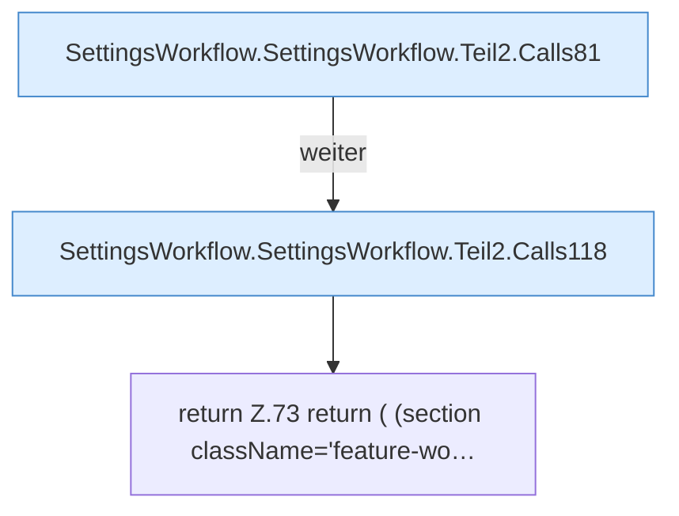

[[00 Start]] › [[Dashboard-UI]] › [[UI-Workflows]] › [[SettingsWorkflow]] › [[SettingsWorkflow.SettingsWorkflow]] › [[SettingsWorkflow.SettingsWorkflow.Teil2]]

# SettingsWorkflow.SettingsWorkflow.Teil2



```knoten
SettingsWorkflow.SettingsWorkflow.Teil2.Calls81
  Weitere [[Glossar#Funktion|Funktionen]], die ab [[Glossar#Zeile|Zeile]] 81 aufgerufen werden. Weitere eigene Aufrufe ab Zeile 81.
SettingsWorkflow.SettingsWorkflow.Teil2.Calls118
  Weitere [[Glossar#Funktion|Funktionen]], die ab [[Glossar#Zeile|Zeile]] 118 aufgerufen werden. Weitere eigene Aufrufe ab Zeile 118.
return Z.73 return ( (section className='feature-wo…
  Zeile 73: Rückgabe `return ( (section className='feature-wo…`.
```

> [!knoten]- Was die Blöcke tun
> - **SettingsWorkflow.SettingsWorkflow.Teil2.Calls81**: Weitere [[Glossar#Funktion|Funktionen]], die ab [[Glossar#Zeile|Zeile]] 81 aufgerufen werden. Weitere eigene Aufrufe ab Zeile 81.
> - **SettingsWorkflow.SettingsWorkflow.Teil2.Calls118**: Weitere [[Glossar#Funktion|Funktionen]], die ab [[Glossar#Zeile|Zeile]] 118 aufgerufen werden. Weitere eigene Aufrufe ab Zeile 118.
> - **return Z.73 return ( (section className='feature-wo…**: Zeile 73: Rückgabe `return ( (section className='feature-wo…`.

- Ein weiterer Abschnitt derselben Übersicht.
- Fortsetzung von `SettingsWorkflow.SettingsWorkflow`.
