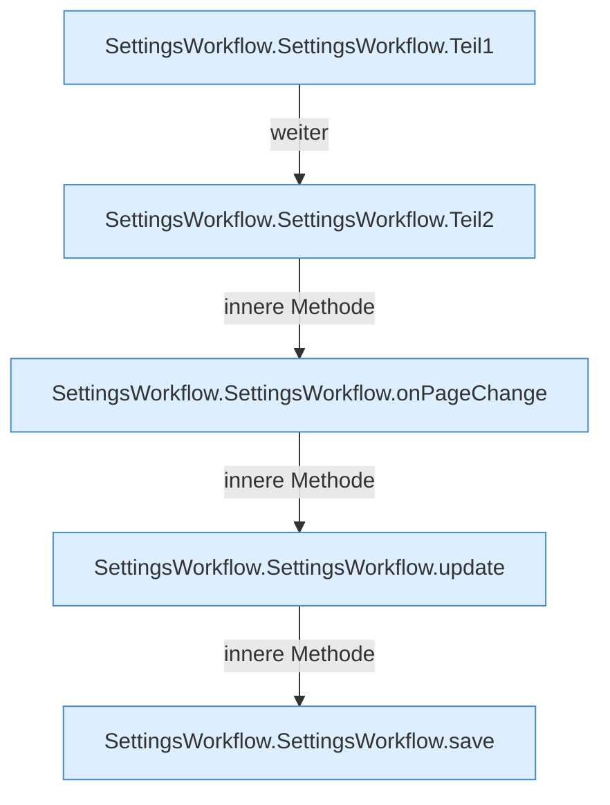

[[00 Start]] › [[Dashboard-UI]] › [[UI-Workflows]] › [[SettingsWorkflow]] › [[SettingsWorkflow.SettingsWorkflow]]

# SettingsWorkflow.SettingsWorkflow

`SettingsWorkflow.SettingsWorkflow()` [ui/src/components/SettingsWorkflow.tsx:18–129](https://github.com/Sciddie/minecraft-serverhoster-plugin/blob/95b02b953b0b4c23673e900e021a7c3c844aa37d/ui/src/components/SettingsWorkflow.tsx#L18-L129)



```knoten
SettingsWorkflow.SettingsWorkflow.Teil1
  Abschnitt 1 dieses Ablaufs, in Quellreihenfolge.
SettingsWorkflow.SettingsWorkflow.Teil2
  Abschnitt 2 dieses Ablaufs, in Quellreihenfolge.
SettingsWorkflow.SettingsWorkflow.onPageChange
  Reagiert `onPageChange`. Ruft `refresh`.
SettingsWorkflow.SettingsWorkflow.update
  Aktualisiert `update`.
SettingsWorkflow.SettingsWorkflow.save
  Speichert `save`. Ruft `saveBackupSettings`, `loadBackupSettings`.
```

- `SettingsWorkflow` in `ui/src/components/SettingsWorkflow.tsx`
