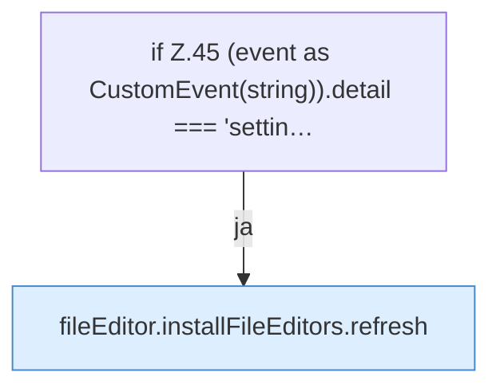

[[00 Start]] › [[Dashboard-UI]] › [[UI-Workflows]] › [[SettingsWorkflow]] › [[SettingsWorkflow.SettingsWorkflow]] › [[SettingsWorkflow.SettingsWorkflow.onPageChange]]

# SettingsWorkflow.SettingsWorkflow.onPageChange

`SettingsWorkflow.onPageChange(event: Event)` [ui/src/components/SettingsWorkflow.tsx:44–46](https://github.com/Sciddie/minecraft-serverhoster-plugin/blob/95b02b953b0b4c23673e900e021a7c3c844aa37d/ui/src/components/SettingsWorkflow.tsx#L44-L46)

- `onPageChange` in `ui/src/components/SettingsWorkflow.tsx`
