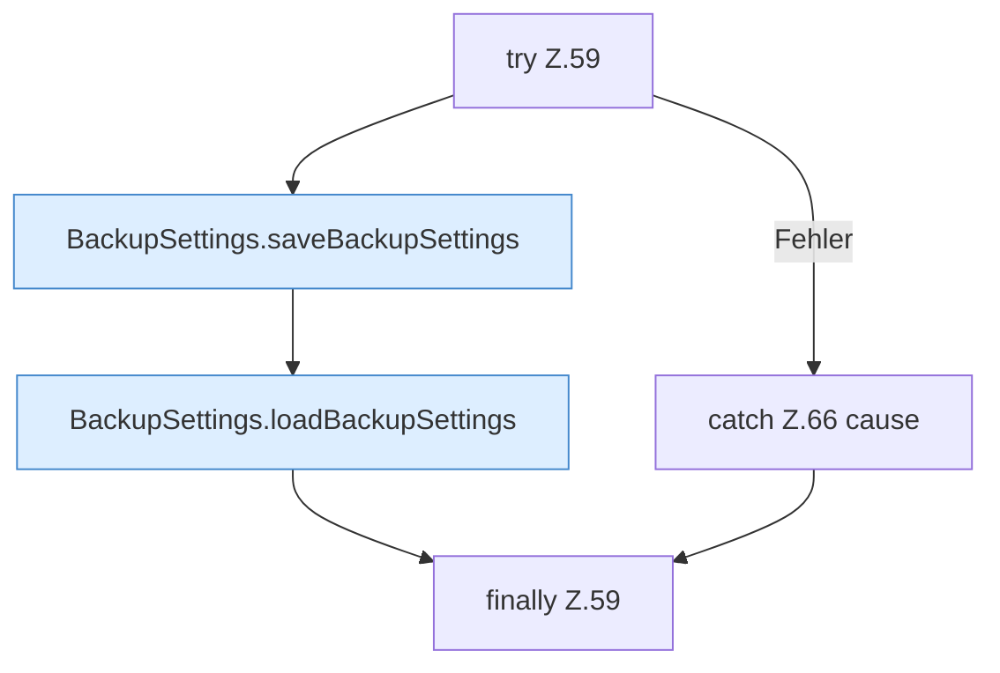

[[00 Start]] › [[Dashboard-UI]] › [[UI-Workflows]] › [[SettingsWorkflow]] › [[SettingsWorkflow.SettingsWorkflow]] › [[SettingsWorkflow.SettingsWorkflow.save]] › [[SettingsWorkflow.SettingsWorkflow.save.Z59]]

# SettingsWorkflow.SettingsWorkflow.save.Z59



```knoten
try Z.59
  Zeile 59: Versuch. Der Fehlerpfad geht in catch.
BackupSettings.saveBackupSettings
  Speichert `saveBackupSettings`. Ruft `dashboardRequest`, `jsonBody`.
BackupSettings.loadBackupSettings
  Lädt `loadBackupSettings`. Ruft `dashboardRequest`.
catch Z.66 cause
  Zeile 66: fängt cause.
finally Z.59
  Läuft danach immer, auch nach einem Fehler.
```

- Fortsetzung von `SettingsWorkflow.SettingsWorkflow.save`, Quellreihenfolge.
