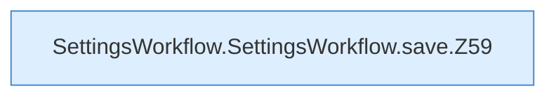

[[00 Start]] › [[Dashboard-UI]] › [[UI-Workflows]] › [[SettingsWorkflow]] › [[SettingsWorkflow.SettingsWorkflow]] › [[SettingsWorkflow.SettingsWorkflow.save]]

# SettingsWorkflow.SettingsWorkflow.save

`SettingsWorkflow.save()` [ui/src/components/SettingsWorkflow.tsx:56–71](https://github.com/Sciddie/minecraft-serverhoster-plugin/blob/95b02b953b0b4c23673e900e021a7c3c844aa37d/ui/src/components/SettingsWorkflow.tsx#L56-L71)

- `save` in `ui/src/components/SettingsWorkflow.tsx`
