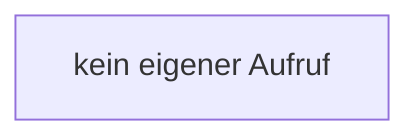

[[00 Start]] › [[Dashboard-UI]] › [[UI-Workflows]] › [[SettingsWorkflow]] › [[SettingsWorkflow.SettingsWorkflow]] › [[SettingsWorkflow.SettingsWorkflow.update]]

# SettingsWorkflow.SettingsWorkflow.update

`SettingsWorkflow.update(key: K, value: Settings[K])` [ui/src/components/SettingsWorkflow.tsx:53–54](https://github.com/Sciddie/minecraft-serverhoster-plugin/blob/95b02b953b0b4c23673e900e021a7c3c844aa37d/ui/src/components/SettingsWorkflow.tsx#L53-L54)



```knoten
kein eigener Aufruf
  In diesem Stück gibt es keinen weiteren eigenen Aufruf.
```

> [!knoten]- Was die Blöcke tun
> - **kein eigener Aufruf**: In diesem Stück gibt es keinen weiteren eigenen Aufruf.

- Die [[Glossar#Bedienseite|Bedienseite]] ändert das.
- `update` in `ui/src/components/SettingsWorkflow.tsx`
