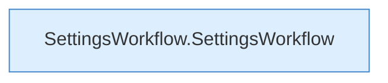

[[00 Start]] › [[Dashboard-UI]] › [[UI-Workflows]] › [[SettingsWorkflow]]

# SettingsWorkflow



```knoten
SettingsWorkflow.SettingsWorkflow
  `SettingsWorkflow` in `SettingsWorkflow.tsx`. Ruft `loadBackupSettings`, `refresh`, `save`.
```


