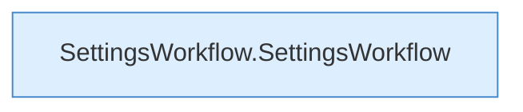

[[00 Start]] › [[Dashboard-UI]] › [[UI-Workflows]] › [[SettingsWorkflow]]

# SettingsWorkflow



```knoten
SettingsWorkflow.SettingsWorkflow
  Die [[Glossar#Bedienseite|Bedienseite]] kümmert sich um den Ablauf. Im [[Glossar#Quelltext|Quelltext]] heißt das `SettingsWorkflow`.
```

> [!knoten]- Was die Blöcke tun
> - **SettingsWorkflow.SettingsWorkflow**: Die [[Glossar#Bedienseite|Bedienseite]] kümmert sich um den Ablauf. Im [[Glossar#Quelltext|Quelltext]] heißt das `SettingsWorkflow`.

- Der Ablauf in der [[Glossar#Bedienseite|Bedienseite]], in dem man [[Glossar#Einstellungen|Einstellungen]] ändert.
