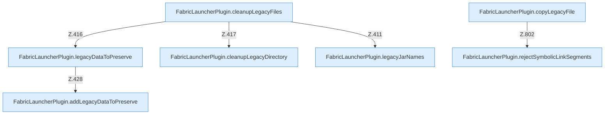

[[00 Start]] › [[Plugin-Kern]] › [[Setup]] › [[Setup-Aufraeumen]]

# Setup-Aufraeumen



```knoten
FabricLauncherPlugin.cleanupLegacyFiles
  Das [[Glossar#Plugin|Plugin]] räumt auf den alten Weg die Dateien. Im [[Glossar#Quelltext|Quelltext]] heißt das `cleanupLegacyFiles`.
FabricLauncherPlugin.legacyDataToPreserve
  Das [[Glossar#Plugin|Plugin]] macht hier einen einzelnen Schritt. Eine Ebene tiefer steht er genauer. Im [[Glossar#Quelltext|Quelltext]] heißt das `legacyDataToPreserve`.
FabricLauncherPlugin.addLegacyDataToPreserve
  Das [[Glossar#Plugin|Plugin]] fügt hinzu den alten Weg. Im [[Glossar#Quelltext|Quelltext]] heißt das `addLegacyDataToPreserve`.
FabricLauncherPlugin.cleanupLegacyDirectory
  Das [[Glossar#Plugin|Plugin]] räumt auf den alten Weg. Im [[Glossar#Quelltext|Quelltext]] heißt das `cleanupLegacyDirectory`.
FabricLauncherPlugin.legacyJarNames
  Das [[Glossar#Plugin|Plugin]] kümmert sich um die [[Glossar#Programmdatei|Programmdatei]] die Namen. Im [[Glossar#Quelltext|Quelltext]] heißt das `legacyJarNames`.
FabricLauncherPlugin.copyLegacyFile
  Das [[Glossar#Plugin|Plugin]] kopiert den alten Weg die Datei. Im [[Glossar#Quelltext|Quelltext]] heißt das `copyLegacyFile`.
FabricLauncherPlugin.rejectSymbolicLinkSegments
  Das [[Glossar#Plugin|Plugin]] macht hier einen einzelnen Schritt. Eine Ebene tiefer steht er genauer. Im [[Glossar#Quelltext|Quelltext]] heißt das `rejectSymbolicLinkSegments`.
```

> [!knoten]- Was die Blöcke tun
> - **FabricLauncherPlugin.cleanupLegacyFiles**: Das [[Glossar#Plugin|Plugin]] räumt auf den alten Weg die Dateien. Im [[Glossar#Quelltext|Quelltext]] heißt das `cleanupLegacyFiles`.
> - **FabricLauncherPlugin.legacyDataToPreserve**: Das [[Glossar#Plugin|Plugin]] macht hier einen einzelnen Schritt. Eine Ebene tiefer steht er genauer. Im [[Glossar#Quelltext|Quelltext]] heißt das `legacyDataToPreserve`.
> - **FabricLauncherPlugin.addLegacyDataToPreserve**: Das [[Glossar#Plugin|Plugin]] fügt hinzu den alten Weg. Im [[Glossar#Quelltext|Quelltext]] heißt das `addLegacyDataToPreserve`.
> - **FabricLauncherPlugin.cleanupLegacyDirectory**: Das [[Glossar#Plugin|Plugin]] räumt auf den alten Weg. Im [[Glossar#Quelltext|Quelltext]] heißt das `cleanupLegacyDirectory`.
> - **FabricLauncherPlugin.legacyJarNames**: Das [[Glossar#Plugin|Plugin]] kümmert sich um die [[Glossar#Programmdatei|Programmdatei]] die Namen. Im [[Glossar#Quelltext|Quelltext]] heißt das `legacyJarNames`.
> - **FabricLauncherPlugin.copyLegacyFile**: Das [[Glossar#Plugin|Plugin]] kopiert den alten Weg die Datei. Im [[Glossar#Quelltext|Quelltext]] heißt das `copyLegacyFile`.
> - **FabricLauncherPlugin.rejectSymbolicLinkSegments**: Das [[Glossar#Plugin|Plugin]] macht hier einen einzelnen Schritt. Eine Ebene tiefer steht er genauer. Im [[Glossar#Quelltext|Quelltext]] heißt das `rejectSymbolicLinkSegments`.

- Räumt nach der [[Glossar#Einrichtung|Einrichtung]] Dateien und Reste weg.
