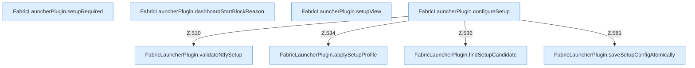

[[00 Start]] › [[Plugin-Kern]] › [[Setup]] › [[Setup-Dialog]]

# Setup-Dialog



```knoten
FabricLauncherPlugin.setupRequired
  Das [[Glossar#Plugin|Plugin]] kümmert sich um einen Pflichtwert. Im [[Glossar#Quelltext|Quelltext]] heißt das `setupRequired`.
FabricLauncherPlugin.dashboardStartBlockReason
  Das [[Glossar#Plugin|Plugin]] startet hier einen Schritt. Eine Ebene tiefer steht er genauer. Im [[Glossar#Quelltext|Quelltext]] heißt das `dashboardStartBlockReason`.
FabricLauncherPlugin.setupView
  Das [[Glossar#Plugin|Plugin]] kümmert sich um die Ansicht. Im [[Glossar#Quelltext|Quelltext]] heißt das `setupView`.
FabricLauncherPlugin.configureSetup
  Das [[Glossar#Plugin|Plugin]] kümmert sich um die [[Glossar#Einrichtung|Einrichtung]]. Im [[Glossar#Quelltext|Quelltext]] heißt das `configureSetup`.
FabricLauncherPlugin.saveSetupConfigAtomically
  Das [[Glossar#Plugin|Plugin]] speichert die [[Glossar#Einrichtung|Einrichtung]] die [[Glossar#Einstellungen|Einstellungen]]. Im [[Glossar#Quelltext|Quelltext]] heißt das `saveSetupConfigAtomically`.
FabricLauncherPlugin.validateNtfySetup
  Das [[Glossar#Plugin|Plugin]] prüft den Mitteilungsdienst die [[Glossar#Einrichtung|Einrichtung]]. Im [[Glossar#Quelltext|Quelltext]] heißt das `validateNtfySetup`.
FabricLauncherPlugin.findSetupCandidate
  Das [[Glossar#Plugin|Plugin]] sucht die [[Glossar#Einrichtung|Einrichtung]]. Im [[Glossar#Quelltext|Quelltext]] heißt das `findSetupCandidate`.
FabricLauncherPlugin.applySetupProfile
  Das [[Glossar#Plugin|Plugin]] wendet an die [[Glossar#Einrichtung|Einrichtung]] die Beschreibung. Im [[Glossar#Quelltext|Quelltext]] heißt das `applySetupProfile`.
```

> [!knoten]- Was die Blöcke tun
> - **FabricLauncherPlugin.setupRequired**: Das [[Glossar#Plugin|Plugin]] kümmert sich um einen Pflichtwert. Im [[Glossar#Quelltext|Quelltext]] heißt das `setupRequired`.
> - **FabricLauncherPlugin.dashboardStartBlockReason**: Das [[Glossar#Plugin|Plugin]] startet hier einen Schritt. Eine Ebene tiefer steht er genauer. Im [[Glossar#Quelltext|Quelltext]] heißt das `dashboardStartBlockReason`.
> - **FabricLauncherPlugin.setupView**: Das [[Glossar#Plugin|Plugin]] kümmert sich um die Ansicht. Im [[Glossar#Quelltext|Quelltext]] heißt das `setupView`.
> - **FabricLauncherPlugin.configureSetup**: Das [[Glossar#Plugin|Plugin]] kümmert sich um die [[Glossar#Einrichtung|Einrichtung]]. Im [[Glossar#Quelltext|Quelltext]] heißt das `configureSetup`.
> - **FabricLauncherPlugin.saveSetupConfigAtomically**: Das [[Glossar#Plugin|Plugin]] speichert die [[Glossar#Einrichtung|Einrichtung]] die [[Glossar#Einstellungen|Einstellungen]]. Im [[Glossar#Quelltext|Quelltext]] heißt das `saveSetupConfigAtomically`.
> - **FabricLauncherPlugin.validateNtfySetup**: Das [[Glossar#Plugin|Plugin]] prüft den Mitteilungsdienst die [[Glossar#Einrichtung|Einrichtung]]. Im [[Glossar#Quelltext|Quelltext]] heißt das `validateNtfySetup`.
> - **FabricLauncherPlugin.findSetupCandidate**: Das [[Glossar#Plugin|Plugin]] sucht die [[Glossar#Einrichtung|Einrichtung]]. Im [[Glossar#Quelltext|Quelltext]] heißt das `findSetupCandidate`.
> - **FabricLauncherPlugin.applySetupProfile**: Das [[Glossar#Plugin|Plugin]] wendet an die [[Glossar#Einrichtung|Einrichtung]] die Beschreibung. Im [[Glossar#Quelltext|Quelltext]] heißt das `applySetupProfile`.

- Die Schritte der [[Glossar#Einrichtung|Einrichtung]], die das [[Glossar#Plugin|Plugin]] selbst ausführt.
