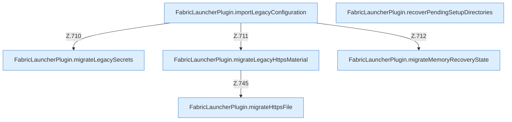

[[00 Start]] › [[Plugin-Kern]] › [[Setup]] › [[Setup-Import]]

# Setup-Import



```knoten
FabricLauncherPlugin.importLegacyConfiguration
  Das [[Glossar#Plugin|Plugin]] übernimmt den alten Weg. Im [[Glossar#Quelltext|Quelltext]] heißt das `importLegacyConfiguration`.
FabricLauncherPlugin.migrateLegacySecrets
  Das [[Glossar#Plugin|Plugin]] übernimmt den alten Wert von den alten Weg die Zugangsdaten. Im [[Glossar#Quelltext|Quelltext]] heißt das `migrateLegacySecrets`.
FabricLauncherPlugin.migrateLegacyHttpsMaterial
  Das [[Glossar#Plugin|Plugin]] übernimmt den alten Wert von den alten Weg die [[Glossar#Verschlüsselung|Verschlüsselung]]. Im [[Glossar#Quelltext|Quelltext]] heißt das `migrateLegacyHttpsMaterial`.
FabricLauncherPlugin.migrateHttpsFile
  Das [[Glossar#Plugin|Plugin]] übernimmt den alten Wert von die [[Glossar#Verschlüsselung|Verschlüsselung]] die Datei. Im [[Glossar#Quelltext|Quelltext]] heißt das `migrateHttpsFile`.
FabricLauncherPlugin.migrateMemoryRecoveryState
  Das [[Glossar#Plugin|Plugin]] übernimmt den alten Wert von den [[Glossar#Arbeitsspeicher|Arbeitsspeicher]] die Wiederherstellung den Zustand. Im [[Glossar#Quelltext|Quelltext]] heißt das `migrateMemoryRecoveryState`.
FabricLauncherPlugin.recoverPendingSetupDirectories
  Das [[Glossar#Plugin|Plugin]] rückt wieder gerade die [[Glossar#Einrichtung|Einrichtung]]. Im [[Glossar#Quelltext|Quelltext]] heißt das `recoverPendingSetupDirectories`.
```

> [!knoten]- Was die Blöcke tun
> - **FabricLauncherPlugin.importLegacyConfiguration**: Das [[Glossar#Plugin|Plugin]] übernimmt den alten Weg. Im [[Glossar#Quelltext|Quelltext]] heißt das `importLegacyConfiguration`.
> - **FabricLauncherPlugin.migrateLegacySecrets**: Das [[Glossar#Plugin|Plugin]] übernimmt den alten Wert von den alten Weg die Zugangsdaten. Im [[Glossar#Quelltext|Quelltext]] heißt das `migrateLegacySecrets`.
> - **FabricLauncherPlugin.migrateLegacyHttpsMaterial**: Das [[Glossar#Plugin|Plugin]] übernimmt den alten Wert von den alten Weg die [[Glossar#Verschlüsselung|Verschlüsselung]]. Im [[Glossar#Quelltext|Quelltext]] heißt das `migrateLegacyHttpsMaterial`.
> - **FabricLauncherPlugin.migrateHttpsFile**: Das [[Glossar#Plugin|Plugin]] übernimmt den alten Wert von die [[Glossar#Verschlüsselung|Verschlüsselung]] die Datei. Im [[Glossar#Quelltext|Quelltext]] heißt das `migrateHttpsFile`.
> - **FabricLauncherPlugin.migrateMemoryRecoveryState**: Das [[Glossar#Plugin|Plugin]] übernimmt den alten Wert von den [[Glossar#Arbeitsspeicher|Arbeitsspeicher]] die Wiederherstellung den Zustand. Im [[Glossar#Quelltext|Quelltext]] heißt das `migrateMemoryRecoveryState`.
> - **FabricLauncherPlugin.recoverPendingSetupDirectories**: Das [[Glossar#Plugin|Plugin]] rückt wieder gerade die [[Glossar#Einrichtung|Einrichtung]]. Im [[Glossar#Quelltext|Quelltext]] heißt das `recoverPendingSetupDirectories`.

- Übernimmt Dateien aus einer älteren Anlage desselben [[Glossar#Plugin|Plugins]].
