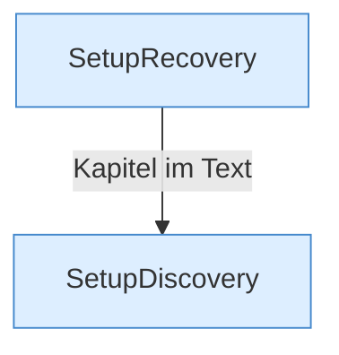

[[00 Start]] › [[Server-Anlage]] › [[Setup-Suche]]

# Setup-Suche



```knoten
SetupRecovery
  Macht aus so einem Treffer wieder eine Anlage, die das [[Glossar#Plugin|Plugin]] benutzen kann.
SetupDiscovery
  Sucht Ordner, die schon wie ein Server aussehen.
```

> [!knoten] Was die Blöcke tun
> - **SetupRecovery**: Macht aus so einem Treffer wieder eine Anlage, die das [[Glossar#Plugin|Plugin]] benutzen kann.
> - **SetupDiscovery**: Sucht Ordner, die schon wie ein Server aussehen.

- Sucht auf der Festplatte nach einer schon vorhandenen Anlage und kann sie wieder benutzbar machen.
