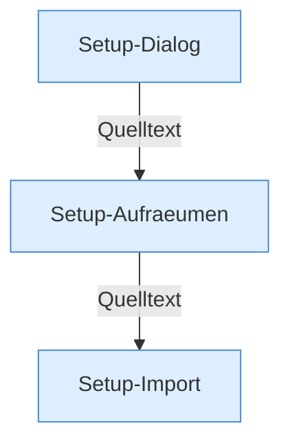

[[00 Start]] › [[Plugin-Kern]] › [[Setup]]

# Setup



```knoten
Setup-Dialog
  Die Einrichtungsschritte, die der Kern selbst ausführt.
Setup-Aufraeumen
  Räumt Dateien und Reste nach der Einrichtung weg.
Setup-Import
  Übernimmt Daten aus einer alten FabricLauncher-Anlage.
```

- Einrichtung, Aufräumen und Import der alten FabricLauncher-Daten.
