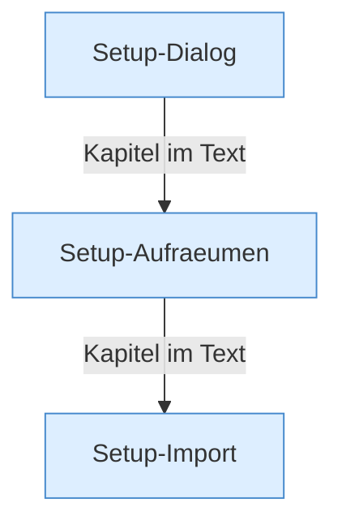

[[00 Start]] › [[Plugin-Kern]] › [[Setup]]

# Setup



```knoten
Setup-Dialog
  Die Schritte der [[Glossar#Einrichtung|Einrichtung]], die das [[Glossar#Plugin|Plugin]] selbst ausführt.
Setup-Aufraeumen
  Räumt nach der [[Glossar#Einrichtung|Einrichtung]] Dateien und Reste weg.
Setup-Import
  Übernimmt Dateien aus einer älteren Anlage desselben [[Glossar#Plugin|Plugins]].
```

> [!knoten] Was die Blöcke tun
> - **Setup-Dialog**: Die Schritte der [[Glossar#Einrichtung|Einrichtung]], die das [[Glossar#Plugin|Plugin]] selbst ausführt.
> - **Setup-Aufraeumen**: Räumt nach der [[Glossar#Einrichtung|Einrichtung]] Dateien und Reste weg.
> - **Setup-Import**: Übernimmt Dateien aus einer älteren Anlage desselben [[Glossar#Plugin|Plugins]].

- Die [[Glossar#Einrichtung|Einrichtung]] des [[Glossar#Spielserver|Spielservers]], das Aufräumen danach, und das Übernehmen von Dateien aus einer älteren Anlage.
