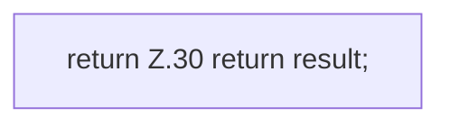

[[00 Start]] › [[Server-Anlage]] › [[Setup-Suche]] › [[SetupDiscovery]] › [[Candidate]] › [[SetupDiscovery.Candidate.view]]

# SetupDiscovery.Candidate.view

`SetupDiscovery.Candidate.view()` [src/main/java/de/aichele/childlauncher/SetupDiscovery.java:19–31](https://github.com/Sciddie/minecraft-serverhoster-plugin/blob/95b02b953b0b4c23673e900e021a7c3c844aa37d/src/main/java/de/aichele/childlauncher/SetupDiscovery.java#L19-L31)



```knoten
return Z.30 return result;
  Zeile 30: Rückgabe `return result;`.
```

> [!knoten]- Was die Blöcke tun
> - **return Z.30 return result;**: Zeile 30: Rückgabe `return result;`.

- Dieser Teil macht hier einen einzelnen Schritt. Eine Ebene tiefer steht er genauer.
- `view` in `src/main/java/de/aichele/childlauncher/SetupDiscovery.java`
