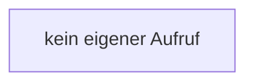

[[00 Start]] › [[Server-Anlage]] › [[Setup-Suche]] › [[SetupDiscovery]] › [[SetupDiscovery.SetupDiscovery]]

# SetupDiscovery.SetupDiscovery

`SetupDiscovery.SetupDiscovery()` [src/main/java/de/aichele/childlauncher/SetupDiscovery.java:36–36](https://github.com/Sciddie/minecraft-serverhoster-plugin/blob/95b02b953b0b4c23673e900e021a7c3c844aa37d/src/main/java/de/aichele/childlauncher/SetupDiscovery.java#L36-L36)



```knoten
kein eigener Aufruf
  In diesem Stück gibt es keinen weiteren eigenen Aufruf.
```

- `SetupDiscovery` in `src/main/java/de/aichele/childlauncher/SetupDiscovery.java`
