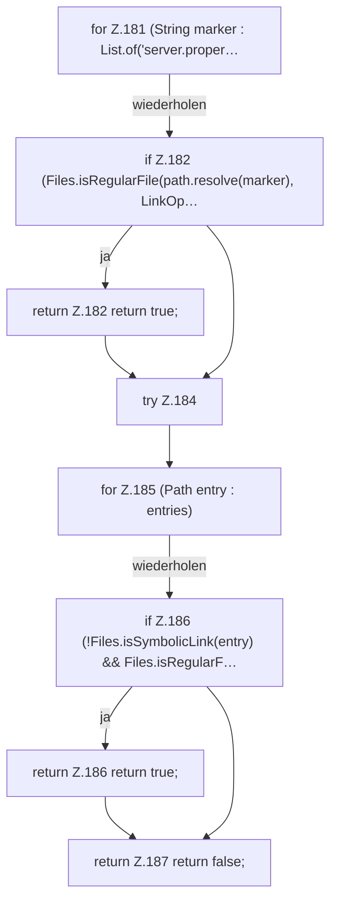

[[00 Start]] › [[Server-Anlage]] › [[Setup-Suche]] › [[SetupDiscovery]] › [[SetupDiscovery.hasServerFiles]]

# SetupDiscovery.hasServerFiles

`SetupDiscovery.hasServerFiles(Path path)` [src/main/java/de/aichele/childlauncher/SetupDiscovery.java:180–189](https://github.com/Sciddie/minecraft-serverhoster-plugin/blob/95b02b953b0b4c23673e900e021a7c3c844aa37d/src/main/java/de/aichele/childlauncher/SetupDiscovery.java#L180-L189)

- `hasServerFiles` in `src/main/java/de/aichele/childlauncher/SetupDiscovery.java`
