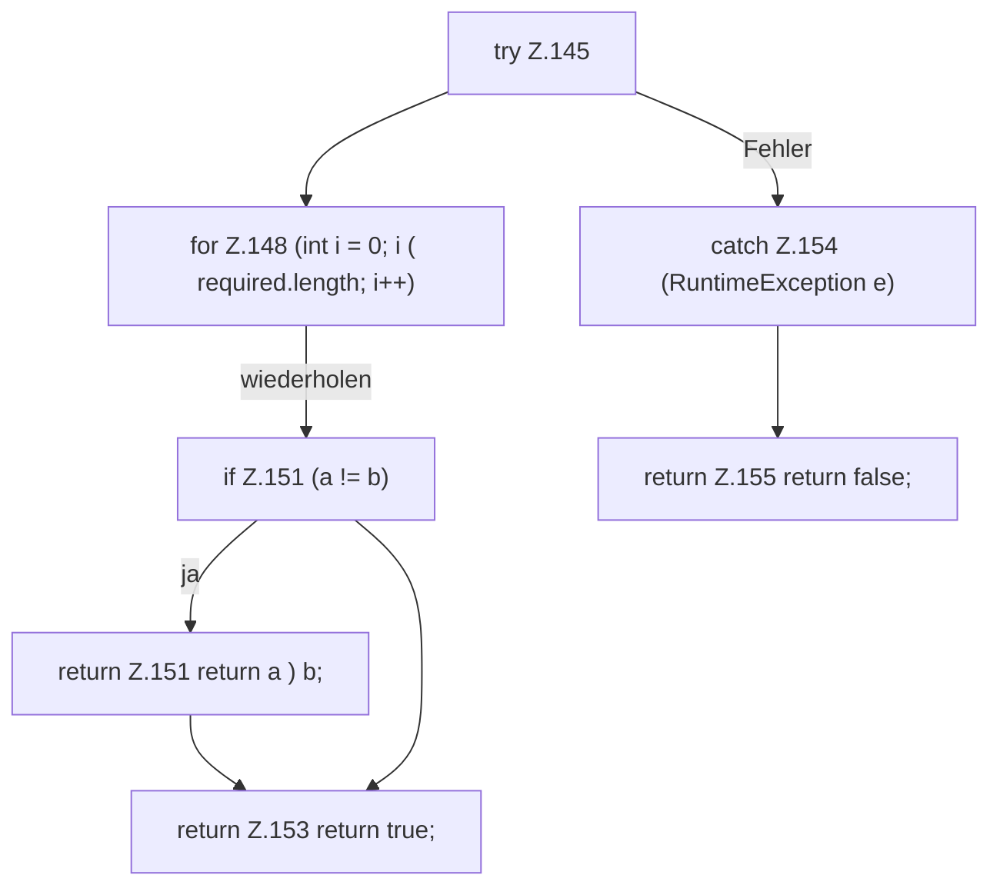

[[00 Start]] › [[Server-Anlage]] › [[Setup-Suche]] › [[SetupDiscovery]] › [[SetupDiscovery.isAtLeast]] › [[SetupDiscovery.isAtLeast.Z145]]

# SetupDiscovery.isAtLeast.Z145



```knoten
try Z.145
  Zeile 145: Versuch. Der Fehlerpfad geht in catch.
for Z.148 (int i = 0; i ( required.length; i++)
  Zeile 148: Schleife `(int i = 0; i ( required.length; i++)`.
if Z.151 (a != b)
  Zeile 151: prüft `(a != b)`.
return Z.151 return a ) b;
  Zeile 151: Rückgabe `return a ) b;`.
return Z.153 return true;
  Zeile 153: Rückgabe `return true;`.
catch Z.154 (RuntimeException e)
  Zeile 154: fängt (RuntimeException e).
return Z.155 return false;
  Zeile 155: Rückgabe `return false;`.
```

- Fortsetzung von `SetupDiscovery.isAtLeast`, Quellreihenfolge.
