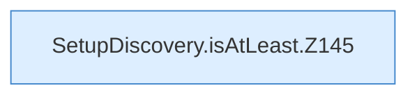

[[00 Start]] › [[Server-Anlage]] › [[Setup-Suche]] › [[SetupDiscovery]] › [[SetupDiscovery.isAtLeast]]

# SetupDiscovery.isAtLeast

`SetupDiscovery.isAtLeast(String version, String minimum)` [src/main/java/de/aichele/childlauncher/SetupDiscovery.java:144–157](https://github.com/Sciddie/minecraft-serverhoster-plugin/blob/95b02b953b0b4c23673e900e021a7c3c844aa37d/src/main/java/de/aichele/childlauncher/SetupDiscovery.java#L144-L157)



```knoten
SetupDiscovery.isAtLeast.Z145
  Fortsetzung des Ablaufs ab Zeile 145.
```

- `isAtLeast` in `src/main/java/de/aichele/childlauncher/SetupDiscovery.java`
