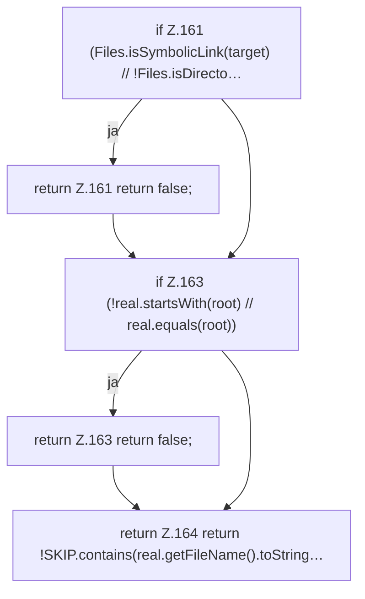

[[00 Start]] › [[Server-Anlage]] › [[Setup-Suche]] › [[SetupDiscovery]] › [[SetupDiscovery.isSafeArchiveTarget]]

# SetupDiscovery.isSafeArchiveTarget

`SetupDiscovery.isSafeArchiveTarget(Path serverRoot, Path target)` [src/main/java/de/aichele/childlauncher/SetupDiscovery.java:159–165](https://github.com/Sciddie/minecraft-serverhoster-plugin/blob/95b02b953b0b4c23673e900e021a7c3c844aa37d/src/main/java/de/aichele/childlauncher/SetupDiscovery.java#L159-L165)

- `isSafeArchiveTarget` in `src/main/java/de/aichele/childlauncher/SetupDiscovery.java`
