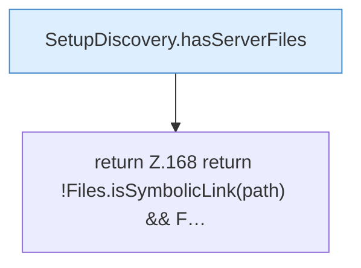

[[00 Start]] › [[Server-Anlage]] › [[Setup-Suche]] › [[SetupDiscovery]] › [[SetupDiscovery.isServerDirectory]]

# SetupDiscovery.isServerDirectory

`SetupDiscovery.isServerDirectory(Path path)` [src/main/java/de/aichele/childlauncher/SetupDiscovery.java:167–170](https://github.com/Sciddie/minecraft-serverhoster-plugin/blob/95b02b953b0b4c23673e900e021a7c3c844aa37d/src/main/java/de/aichele/childlauncher/SetupDiscovery.java#L167-L170)



```knoten
SetupDiscovery.hasServerFiles
  Dieser Teil prüft den Server die Dateien. Prüft `hasServerFiles`.
return Z.168 return !Files.isSymbolicLink(path) && F…
  Zeile 168: Rückgabe `return !Files.isSymbolicLink(path) && F…`.
```

> [!knoten]- Was die Blöcke tun
> - **SetupDiscovery.hasServerFiles**: Dieser Teil prüft den Server die Dateien. Prüft `hasServerFiles`.
> - **return Z.168 return !Files.isSymbolicLink(path) && F…**: Zeile 168: Rückgabe `return !Files.isSymbolicLink(path) && F…`.

- Dieser Teil prüft den Server.
- `isServerDirectory` in `src/main/java/de/aichele/childlauncher/SetupDiscovery.java`
