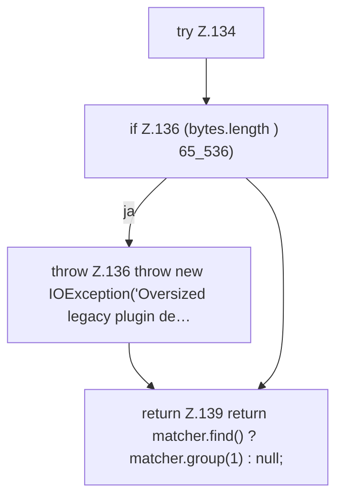

[[00 Start]] › [[Server-Anlage]] › [[Setup-Suche]] › [[SetupDiscovery]] › [[SetupDiscovery.legacyPluginVersion]] › [[SetupDiscovery.legacyPluginVersion.Z131.Z134]]

# SetupDiscovery.legacyPluginVersion.Z131.Z134



```knoten
try Z.134
  Zeile 134: Versuch. Der Fehlerpfad geht in catch.
if Z.136 (bytes.length ) 65_536)
  Zeile 136: prüft `(bytes.length ) 65_536)`.
throw Z.136 throw new IOException('Oversized legacy plugin de…
  Zeile 136: Abbruch `throw new IOException('Oversized legacy plugin de…`.
return Z.139 return matcher.find() ? matcher.group(1) : null;
  Zeile 139: Rückgabe `return matcher.find() ? matcher.group(1) : null;`.
```

- Fortsetzung von `SetupDiscovery.legacyPluginVersion.Z131`, Quellreihenfolge.
