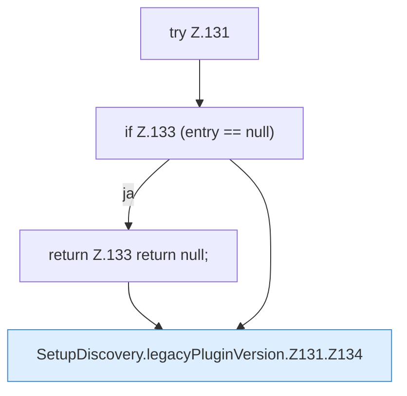

[[00 Start]] › [[Server-Anlage]] › [[Setup-Suche]] › [[SetupDiscovery]] › [[SetupDiscovery.legacyPluginVersion]] › [[SetupDiscovery.legacyPluginVersion.Z131]]

# SetupDiscovery.legacyPluginVersion.Z131



```knoten
try Z.131
  Zeile 131: Versuch. Der Fehlerpfad geht in catch.
if Z.133 (entry == null)
  Zeile 133: prüft `(entry == null)`.
return Z.133 return null;
  Zeile 133: Rückgabe `return null;`.
SetupDiscovery.legacyPluginVersion.Z131.Z134
  Der Ablauf geht in [[Glossar#Zeile|Zeile]] 134 weiter. Eine Ebene tiefer steht er genauer. Fortsetzung des Ablaufs ab Zeile 134.
```

> [!knoten]- Was die Blöcke tun
> - **try Z.131**: Zeile 131: Versuch. Der Fehlerpfad geht in catch.
> - **if Z.133 (entry == null)**: Zeile 133: prüft `(entry == null)`.
> - **return Z.133 return null;**: Zeile 133: Rückgabe `return null;`.
> - **SetupDiscovery.legacyPluginVersion.Z131.Z134**: Der Ablauf geht in [[Glossar#Zeile|Zeile]] 134 weiter. Eine Ebene tiefer steht er genauer. Fortsetzung des Ablaufs ab Zeile 134.

- Der Ablauf geht in [[Glossar#Zeile|Zeile]] 131 weiter. Eine Ebene tiefer steht er genauer.
- Fortsetzung von `SetupDiscovery.legacyPluginVersion`.
