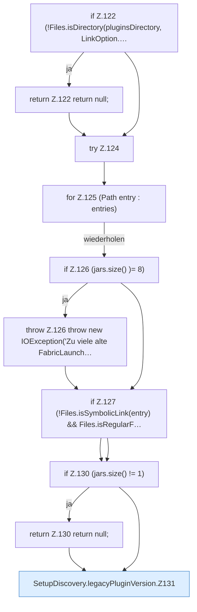

[[00 Start]] › [[Server-Anlage]] › [[Setup-Suche]] › [[SetupDiscovery]] › [[SetupDiscovery.legacyPluginVersion]]

# SetupDiscovery.legacyPluginVersion

`SetupDiscovery.legacyPluginVersion(Path pluginsDirectory)` [src/main/java/de/aichele/childlauncher/SetupDiscovery.java:121–142](https://github.com/Sciddie/minecraft-serverhoster-plugin/blob/95b02b953b0b4c23673e900e021a7c3c844aa37d/src/main/java/de/aichele/childlauncher/SetupDiscovery.java#L121-L142)



```knoten
if Z.122 (!Files.isDirectory(pluginsDirectory, LinkOption.…
  Zeile 122: prüft `(!Files.isDirectory(pluginsDirectory, LinkOption.…`.
return Z.122 return null;
  Zeile 122: Rückgabe `return null;`.
try Z.124
  Zeile 124: Versuch. Der Fehlerpfad geht in catch.
for Z.125 (Path entry : entries)
  Zeile 125: Schleife `(Path entry : entries)`.
if Z.126 (jars.size() )= 8)
  Zeile 126: prüft `(jars.size() )= 8)`.
throw Z.126 throw new IOException('Zu viele alte FabricLaunch…
  Zeile 126: Abbruch `throw new IOException('Zu viele alte FabricLaunch…`.
if Z.127 (!Files.isSymbolicLink(entry) && Files.isRegularF…
  Zeile 127: prüft `(!Files.isSymbolicLink(entry) && Files.isRegularF…`.
if Z.130 (jars.size() != 1)
  Zeile 130: prüft `(jars.size() != 1)`.
return Z.130 return null;
  Zeile 130: Rückgabe `return null;`.
SetupDiscovery.legacyPluginVersion.Z131
  Fortsetzung des Ablaufs ab Zeile 131.
```

- `legacyPluginVersion` in `src/main/java/de/aichele/childlauncher/SetupDiscovery.java`
