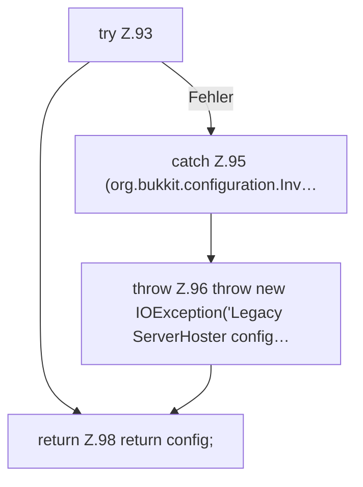

[[00 Start]] › [[Server-Anlage]] › [[Setup-Suche]] › [[SetupDiscovery]] › [[SetupDiscovery.loadLegacyConfig]]

# SetupDiscovery.loadLegacyConfig

`SetupDiscovery.loadLegacyConfig(Path path)` [src/main/java/de/aichele/childlauncher/SetupDiscovery.java:91–99](https://github.com/Sciddie/minecraft-serverhoster-plugin/blob/95b02b953b0b4c23673e900e021a7c3c844aa37d/src/main/java/de/aichele/childlauncher/SetupDiscovery.java#L91-L99)



```knoten
try Z.93
  Zeile 93: Versuch. Der Fehlerpfad geht in catch.
catch Z.95 (org.bukkit.configuration.Inv…
  Zeile 95: fängt (org.bukkit.configuration.Inv….
throw Z.96 throw new IOException('Legacy ServerHoster config…
  Zeile 96: Abbruch `throw new IOException('Legacy ServerHoster config…`.
return Z.98 return config;
  Zeile 98: Rückgabe `return config;`.
```

> [!knoten]- Was die Blöcke tun
> - **try Z.93**: Zeile 93: Versuch. Der Fehlerpfad geht in catch.
> - **catch Z.95 (org.bukkit.configuration.Inv…**: Zeile 95: fängt (org.bukkit.configuration.Inv….
> - **throw Z.96 throw new IOException('Legacy ServerHoster config…**: Zeile 96: Abbruch `throw new IOException('Legacy ServerHoster config…`.
> - **return Z.98 return config;**: Zeile 98: Rückgabe `return config;`.

- Dieser Teil lädt den alten Weg die [[Glossar#Einstellungen|Einstellungen]].
- `loadLegacyConfig` in `src/main/java/de/aichele/childlauncher/SetupDiscovery.java`
