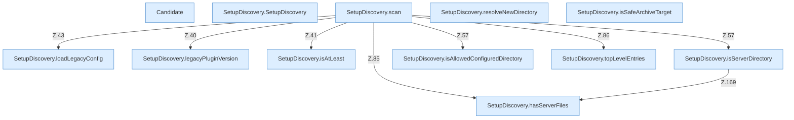

[[00 Start]] › [[Server-Anlage]] › [[Setup-Suche]] › [[SetupDiscovery]]

# SetupDiscovery



```knoten
Candidate
  Ein Treffer der Suche: Pfad, Profil, ob schon Dateien da sind.
SetupDiscovery.SetupDiscovery
  `SetupDiscovery` in `SetupDiscovery.java`.
SetupDiscovery.scan
  Durchsucht `scan`. Ruft `legacyPluginVersion`, `isAtLeast`, `loadLegacyConfig`.
SetupDiscovery.loadLegacyConfig
  Lädt `loadLegacyConfig`.
SetupDiscovery.resolveNewDirectory
  Löst auf `resolveNewDirectory`.
SetupDiscovery.legacyPluginVersion
  `legacyPluginVersion` in `SetupDiscovery.java`.
SetupDiscovery.isAtLeast
  Prüft `isAtLeast`.
SetupDiscovery.isSafeArchiveTarget
  Prüft `isSafeArchiveTarget`.
SetupDiscovery.isServerDirectory
  Prüft `isServerDirectory`. Ruft `hasServerFiles`.
SetupDiscovery.isAllowedConfiguredDirectory
  Prüft `isAllowedConfiguredDirectory`.
SetupDiscovery.hasServerFiles
  Prüft `hasServerFiles`.
SetupDiscovery.topLevelEntries
  `topLevelEntries` in `SetupDiscovery.java`.
```


