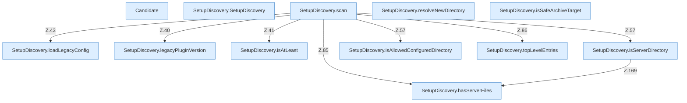

[[00 Start]] › [[Server-Anlage]] › [[Setup-Suche]] › [[SetupDiscovery]]

# SetupDiscovery



```knoten
Candidate
  Ein Treffer dieser Suche: ein Ordner, der eine Anlage sein könnte.
SetupDiscovery.SetupDiscovery
  Dieser Teil kümmert sich um die Suche. Im [[Glossar#Quelltext|Quelltext]] heißt das `SetupDiscovery`.
SetupDiscovery.scan
  Dieser Teil macht hier einen einzelnen Schritt. Eine Ebene tiefer steht er genauer. Im [[Glossar#Quelltext|Quelltext]] heißt das `scan`.
SetupDiscovery.loadLegacyConfig
  Dieser Teil lädt den alten Weg die [[Glossar#Einstellungen|Einstellungen]]. Im [[Glossar#Quelltext|Quelltext]] heißt das `loadLegacyConfig`.
SetupDiscovery.resolveNewDirectory
  Dieser Teil bestimmt hier einen Schritt. Eine Ebene tiefer steht er genauer. Im [[Glossar#Quelltext|Quelltext]] heißt das `resolveNewDirectory`.
SetupDiscovery.legacyPluginVersion
  Dieser Teil kümmert sich um das [[Glossar#Plugin|Plugin]] die [[Glossar#Version|Version]]. Im [[Glossar#Quelltext|Quelltext]] heißt das `legacyPluginVersion`.
SetupDiscovery.isAtLeast
  Dieser Teil prüft hier einen Schritt. Eine Ebene tiefer steht er genauer. Im [[Glossar#Quelltext|Quelltext]] heißt das `isAtLeast`.
SetupDiscovery.isSafeArchiveTarget
  Dieser Teil prüft die erlaubte Grenze. Im [[Glossar#Quelltext|Quelltext]] heißt das `isSafeArchiveTarget`.
SetupDiscovery.isServerDirectory
  Dieser Teil prüft den Server. Im [[Glossar#Quelltext|Quelltext]] heißt das `isServerDirectory`.
SetupDiscovery.isAllowedConfiguredDirectory
  Dieser Teil prüft die Einstellung. Im [[Glossar#Quelltext|Quelltext]] heißt das `isAllowedConfiguredDirectory`.
SetupDiscovery.hasServerFiles
  Dieser Teil prüft den Server die Dateien. Im [[Glossar#Quelltext|Quelltext]] heißt das `hasServerFiles`.
SetupDiscovery.topLevelEntries
  Dieser Teil macht hier einen einzelnen Schritt. Eine Ebene tiefer steht er genauer. Im [[Glossar#Quelltext|Quelltext]] heißt das `topLevelEntries`.
```

> [!knoten]- Was die Blöcke tun
> - **Candidate**: Ein Treffer dieser Suche: ein Ordner, der eine Anlage sein könnte.
> - **SetupDiscovery.SetupDiscovery**: Dieser Teil kümmert sich um die Suche. Im [[Glossar#Quelltext|Quelltext]] heißt das `SetupDiscovery`.
> - **SetupDiscovery.scan**: Dieser Teil macht hier einen einzelnen Schritt. Eine Ebene tiefer steht er genauer. Im [[Glossar#Quelltext|Quelltext]] heißt das `scan`.
> - **SetupDiscovery.loadLegacyConfig**: Dieser Teil lädt den alten Weg die [[Glossar#Einstellungen|Einstellungen]]. Im [[Glossar#Quelltext|Quelltext]] heißt das `loadLegacyConfig`.
> - **SetupDiscovery.resolveNewDirectory**: Dieser Teil bestimmt hier einen Schritt. Eine Ebene tiefer steht er genauer. Im [[Glossar#Quelltext|Quelltext]] heißt das `resolveNewDirectory`.
> - **SetupDiscovery.legacyPluginVersion**: Dieser Teil kümmert sich um das [[Glossar#Plugin|Plugin]] die [[Glossar#Version|Version]]. Im [[Glossar#Quelltext|Quelltext]] heißt das `legacyPluginVersion`.
> - **SetupDiscovery.isAtLeast**: Dieser Teil prüft hier einen Schritt. Eine Ebene tiefer steht er genauer. Im [[Glossar#Quelltext|Quelltext]] heißt das `isAtLeast`.
> - **SetupDiscovery.isSafeArchiveTarget**: Dieser Teil prüft die erlaubte Grenze. Im [[Glossar#Quelltext|Quelltext]] heißt das `isSafeArchiveTarget`.
> - **SetupDiscovery.isServerDirectory**: Dieser Teil prüft den Server. Im [[Glossar#Quelltext|Quelltext]] heißt das `isServerDirectory`.
> - **SetupDiscovery.isAllowedConfiguredDirectory**: Dieser Teil prüft die Einstellung. Im [[Glossar#Quelltext|Quelltext]] heißt das `isAllowedConfiguredDirectory`.
> - **SetupDiscovery.hasServerFiles**: Dieser Teil prüft den Server die Dateien. Im [[Glossar#Quelltext|Quelltext]] heißt das `hasServerFiles`.
> - **SetupDiscovery.topLevelEntries**: Dieser Teil macht hier einen einzelnen Schritt. Eine Ebene tiefer steht er genauer. Im [[Glossar#Quelltext|Quelltext]] heißt das `topLevelEntries`.

- Sucht Ordner, die schon wie ein Server aussehen.
