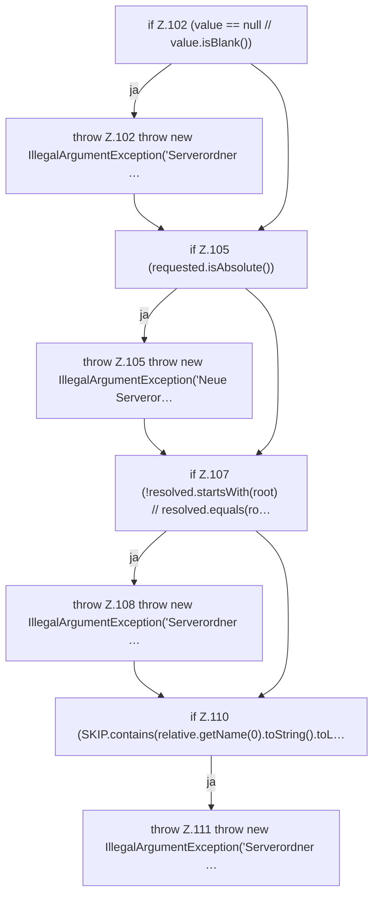

[[00 Start]] › [[Server-Anlage]] › [[Setup-Suche]] › [[SetupDiscovery]] › [[SetupDiscovery.resolveNewDirectory]] › [[SetupDiscovery.resolveNewDirectory.Teil1]]

# SetupDiscovery.resolveNewDirectory.Teil1



```knoten
if Z.102 (value == null // value.isBlank())
  Zeile 102: prüft `(value == null // value.isBlank())`.
throw Z.102 throw new IllegalArgumentException('Serverordner …
  Zeile 102: Abbruch `throw new IllegalArgumentException('Serverordner …`.
if Z.105 (requested.isAbsolute())
  Zeile 105: prüft `(requested.isAbsolute())`.
throw Z.105 throw new IllegalArgumentException('Neue Serveror…
  Zeile 105: Abbruch `throw new IllegalArgumentException('Neue Serveror…`.
if Z.107 (!resolved.startsWith(root) // resolved.equals(ro…
  Zeile 107: prüft `(!resolved.startsWith(root) // resolved.equals(ro…`.
throw Z.108 throw new IllegalArgumentException('Serverordner …
  Zeile 108: Abbruch `throw new IllegalArgumentException('Serverordner …`.
if Z.110 (SKIP.contains(relative.getName(0).toString().toL…
  Zeile 110: prüft `(SKIP.contains(relative.getName(0).toString().toL…`.
throw Z.111 throw new IllegalArgumentException('Serverordner …
  Zeile 111: Abbruch `throw new IllegalArgumentException('Serverordner …`.
```

- Fortsetzung von `SetupDiscovery.resolveNewDirectory`, Quellreihenfolge.
