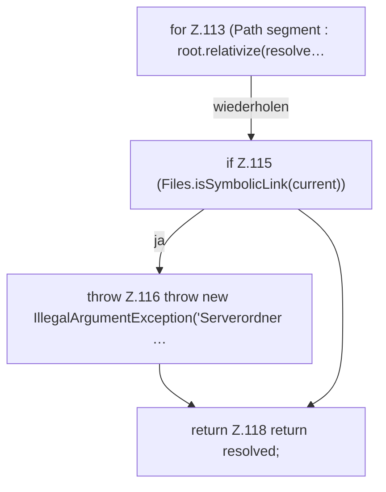

[[00 Start]] › [[Server-Anlage]] › [[Setup-Suche]] › [[SetupDiscovery]] › [[SetupDiscovery.resolveNewDirectory]] › [[SetupDiscovery.resolveNewDirectory.Teil2]]

# SetupDiscovery.resolveNewDirectory.Teil2



```knoten
for Z.113 (Path segment : root.relativize(resolve…
  Zeile 113: Schleife `(Path segment : root.relativize(resolve…`.
if Z.115 (Files.isSymbolicLink(current))
  Zeile 115: prüft `(Files.isSymbolicLink(current))`.
throw Z.116 throw new IllegalArgumentException('Serverordner …
  Zeile 116: Abbruch `throw new IllegalArgumentException('Serverordner …`.
return Z.118 return resolved;
  Zeile 118: Rückgabe `return resolved;`.
```

> [!knoten]- Was die Blöcke tun
> - **for Z.113 (Path segment : root.relativize(resolve…**: Zeile 113: Schleife `(Path segment : root.relativize(resolve…`.
> - **if Z.115 (Files.isSymbolicLink(current))**: Zeile 115: prüft `(Files.isSymbolicLink(current))`.
> - **throw Z.116 throw new IllegalArgumentException('Serverordner …**: Zeile 116: Abbruch `throw new IllegalArgumentException('Serverordner …`.
> - **return Z.118 return resolved;**: Zeile 118: Rückgabe `return resolved;`.

- Ein weiterer Abschnitt derselben Übersicht.
- Fortsetzung von `SetupDiscovery.resolveNewDirectory`.
