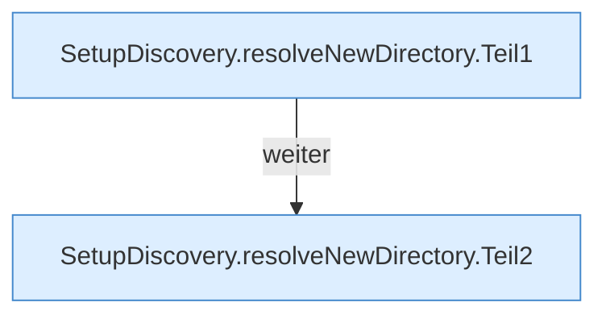

[[00 Start]] › [[Server-Anlage]] › [[Setup-Suche]] › [[SetupDiscovery]] › [[SetupDiscovery.resolveNewDirectory]]

# SetupDiscovery.resolveNewDirectory

`SetupDiscovery.resolveNewDirectory(Path serverRoot, String value)` [src/main/java/de/aichele/childlauncher/SetupDiscovery.java:101–119](https://github.com/Sciddie/minecraft-serverhoster-plugin/blob/95b02b953b0b4c23673e900e021a7c3c844aa37d/src/main/java/de/aichele/childlauncher/SetupDiscovery.java#L101-L119)



```knoten
SetupDiscovery.resolveNewDirectory.Teil1
  Abschnitt 1 dieses Ablaufs, in Quellreihenfolge.
SetupDiscovery.resolveNewDirectory.Teil2
  Abschnitt 2 dieses Ablaufs, in Quellreihenfolge.
```

- `resolveNewDirectory` in `src/main/java/de/aichele/childlauncher/SetupDiscovery.java`
